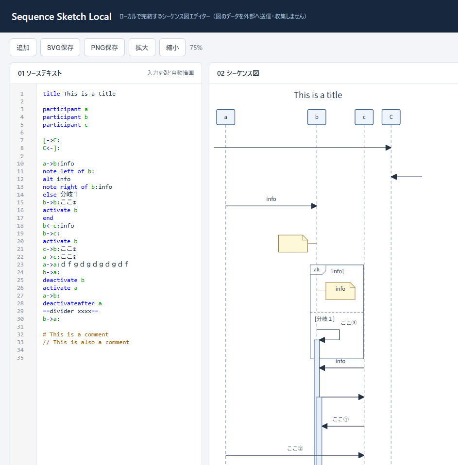

# [Sequence Sketch Local](https://su5filed.github.io/sequence-sketch-local/sequence-editor.html)

**テキストでも、マウスでも。ローカルで完結するシーケンス図エディターです。**

左側にテキストを書くと、右側にシーケンス図を描画します。図上で矢印や注釈を追加・移動すると、テキストにも反映されます。

[SequenceDiagram.org](https://sequencediagram.org/) の使い勝手と記法を参考に、インターネットに接続できない環境でも手軽に作図できるツールを目指して作成しました。同サービスとは関係のない独立したプロジェクトで、構文は一部に対応しています。

## 特徴

- **オフライン動作**：アプリ本体はHTMLファイル1つ。インストール・サーバー・外部ライブラリは不要です。
- **テキストと図の双方向編集**：入力でもドラッグ操作でも、図とソースを更新できます。
- **基本的なシーケンス図に対応**：参加者、矢印、自己呼び出し、外部とのメッセージ、note、activation、alt／else、dividerを扱えます。
- **画像出力**：SVG・PNG保存に対応しています。
- **図のデータを送信・収集しません**：作図はブラウザ内で処理し、アクセス解析や広告は組み込んでいません。

## 使い方

1. ファイル一式をダウンロードして展開します。
2. `index.html`（配布ファイルが `sequence-editor.html` の場合はそちら）をEdgeまたはChromeで開きます。
3. 左側へソースを入力するか、右側の生命線をドラッグして矢印を追加します。注釈や分岐は右クリックメニューから追加できます。

図形や文字はダブルクリックで編集できます。詳しい操作はHelpのInstructions、変更履歴はRelease Notesをご覧ください。

**ソースの自動保存はありません。** ページを閉じたり再読み込みしたりする前に、左側のテキストをコピーして保管してください。画像の保存先指定には、対応するデスクトップ版EdgeまたはChromeが必要です。

## 開発について

現在は試作品です。SequenceDiagram.orgの全機能・全構文には対応していません。バグ報告や機能提案、改善のPull Requestを歓迎します。

## プライバシー

アプリは入力したソースや図を外部へ送信しません。外部リンクを開いた際やGitHub／GitHub Pagesで閲覧した際の通信・アクセス情報は、各サービスの取り扱いに従います。詳細はアプリ内のHelp → Privacy Policyをご覧ください。
